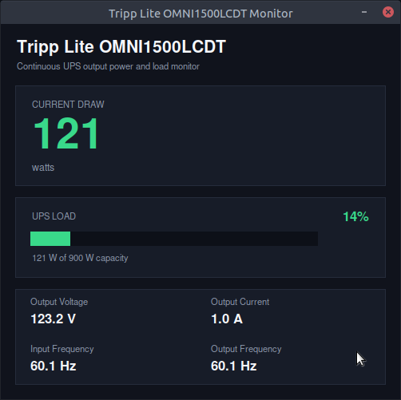
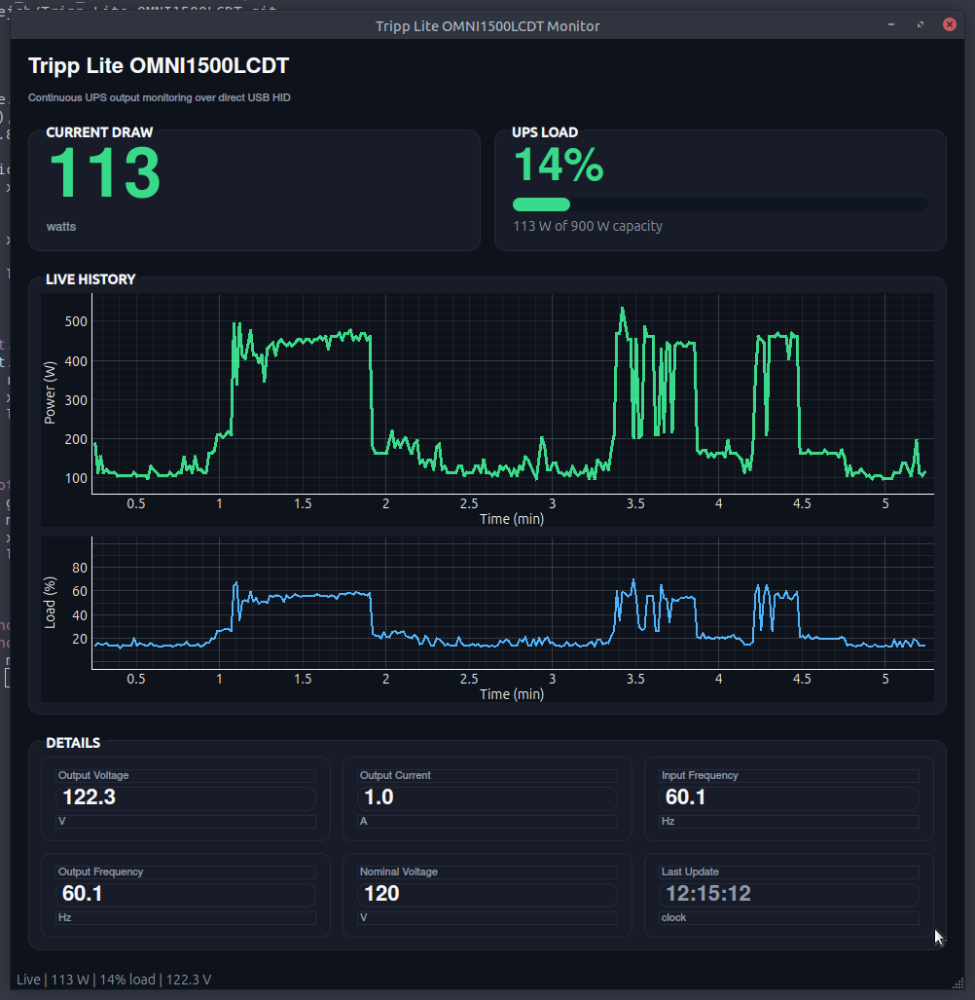

# Tripp Lite OMNI1500LCDT UPS Power Monitor

A Python toolkit to read real-time power consumption data directly from a Tripp Lite OMNI1500LCDT UPS via its USB HID interface, without requiring Network UPS Tools (NUT). Includes a reusable HID reader, a command-line tool, a simple GUI, and an advanced dashboard.

## UPS Specifications

| Spec | Value |
|------|-------|
| Model | Tripp Lite OMNI1500LCDT |
| Capacity | 1500VA / 900W |
| Input | 120VAC @ 60Hz (nominal) |
| Output | 120VAC @ 60Hz (nominal) |
| Battery | Internal sealed lead-acid (12V) |
| USB Interface | HID-compliant (VID: 0x09AE, PID: 0x3016) |

## Available Tools

| Tool | Description | Dependencies |
|------|-------------|--------------|
| `ups_device.py` | Shared direct-HID reader used by all apps | Python 3 only |
| `ups_status.py` | Command-line power reader | Python 3 only |
| `ups_monitor_tk.py` | Simple GUI dashboard | Python 3 (tkinter built-in) |
| `ups_monitor_pyqt5.py` | Advanced dashboard with live charts | PyQt5, pyqtgraph |

## Requirements

- Linux system with `hidraw` support
- Python 3.8+
- UPS connected via USB

## Setup

### 1. Connect the UPS via USB

### 2. Verify the device:
```bash
lsusb | grep -i tripp
# Should show: Bus 001 Device XX: ID 09ae:3016 Tripp Lite OMNI1500LCDT
```

### 3. Set permissions (may need sudo):
```bash
sudo chmod 666 /dev/hidraw0
```

### 4. Make scripts executable (optional):
```bash
chmod +x *.py
```

### For PyQt5 Dashboard (already on Ubuntu):
```bash
# PyQt5 and pyqtgraph are pre-installed on most Ubuntu systems
# If needed:
sudo apt install python3-pyqt5 python3-pyqtgraph
```

### Building a Standalone Executable (Optional)

If you want to compile `ups_monitor_pyqt5.py` into a single, standalone Unix executable that can run on other systems of the same architecture without installing Python dependencies, you can use PyInstaller:

1. **Create and activate a virtual environment:**
   ```bash
   python3 -m venv .venv
   source .venv/bin/activate
   ```

2. **Install dependencies and PyInstaller:**
   ```bash
   pip install pyinstaller pyqt5 pyqtgraph
   ```

3. **Build the executable:**
   ```bash
   pyinstaller --onefile --windowed --name ups_monitor_pyqt5 ups_monitor_pyqt5.py
   ```

The standalone executable will be generated at `./dist/ups_monitor_pyqt5`.

You can run it directly:
```bash
./dist/ups_monitor_pyqt5
```

*Note: The executable still requires appropriate permissions to access `/dev/hidraw0`. See the [Troubleshooting](#permission-denied) section for setting up udev rules.*

---

## Usage

### Option 1: Command-Line (`ups_status.py`)
Quick terminal output every run:
```bash
python3 ups_status.py
```

**Sample output:**
```
load_percent=22
active_power_watts=162
voltage_volts=122.3
current_amps=1.3
input_frequency_hz=60.2
output_frequency_hz=60.1
nominal_voltage_volts=120
```

For periodic updates:
```bash
watch -n 2 python3 ups_status.py
```

---

### Option 2: Simple GUI (`ups_monitor_tk.py`)
Lightweight graphical dashboard with automatic updates:

```bash
python3 ups_monitor_tk.py
```

**Features:**
- Large wattage display
- Load percentage with progress bar
- Voltage, current, frequency readings
- Auto-updates every second
- Color-coded alerts (green/yellow/red)

---

### Option 3: Advanced Dashboard (`ups_monitor_pyqt5.py`)
Professional monitoring interface with real-time charts:

```bash
python3 ups_monitor_pyqt5.py
```

**Features:**
- Separate live power and load history charts (last 5 minutes)
- Large numeric displays
- Detailed metric panels
- Color-coded load warnings
- Dark theme UI
- Auto-updates every second

---

## Metrics

| Field | Description |
|-------|-------------|
| `load_percent` | Current load as percentage of UPS capacity |
| `active_power_watts` | Real power consumption in watts |
| `voltage_volts` | Output voltage |
| `current_amps` | Output current |
| `input_frequency_hz` | Input AC frequency |
| `output_frequency_hz` | Output AC frequency |
| `nominal_voltage_volts` | Configured nominal voltage |

## HID Report IDs

| ID | Purpose | Units |
|----|---------|-------|
| 0x30 | ConfigVoltage | Volts (integer) |
| 0x1E | PercentLoad | Percentage (0-100) |
| 0x31 | Voltage | Decivolts (0.1V) |
| 0x46 | Current | Deciamps (0.1A) |
| 0x47 | ActivePower | Watts |
| 0x19 | Input Frequency | Decihertz (0.1Hz) |
| 0x1C | Output Frequency | Decihertz (0.1Hz) |

---

## Troubleshooting

### Permission denied
If you get "Permission denied" when accessing `/dev/hidraw0`:
```bash
sudo chmod 666 /dev/hidraw0
```

**Permanent fix** - create a udev rule:
```bash
echo 'SUBSYSTEM=="hidraw", ATTRS{idVendor}=="09ae", ATTRS{idProduct}=="3016", MODE="0666"' | sudo tee /etc/udev/rules.d/99-tripp-lite-ups.rules
sudo udevadm control --reload-rules
sudo udevadm trigger
```

### Device not found
Ensure the UPS is connected and detected:
```bash
lsusb | grep -i tripp
ls -la /dev/hidraw*
```

If hidraw0 is missing, unplug and replug the UPS USB cable.

### GUI won't start
Check Python dependencies:
```bash
# For tkinter (built-in, but verify)
python3 -c "import tkinter; print('OK')"

# For PyQt5/PyQtGraph
python3 -c "import PyQt5; import pyqtgraph; print('OK')"
```

---

## Screenshots

**Simple GUI (tkinter):**



- Dark theme dashboard
- Large watts display
- Load progress bar
- Color-coded status

**Advanced Dashboard (PyQt5):**



- Real-time line graph
- Multi-metric displays
- Professional monitoring interface

---

## License

Public Domain / MIT
